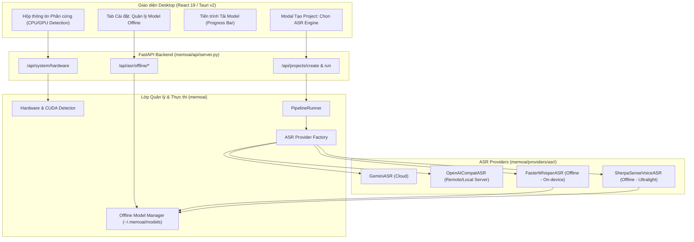

# Feature Plan: Đa dạng hóa Phương thức Nhận dạng Giọng nói & Tích hợp Offline ASR cho MemoAI

> **Tài liệu Kế hoạch Tính năng (Feature Plan)**  
> **Dự án:** MemoAI (Desktop App học tiếng Nhật qua phụ đề song ngữ)  
> **Chủ đề:** Tích hợp nhận dạng giọng nói Offline (On-Device ASR) & Mở rộng đa cơ chế nhận dạng  
> **Trạng thái:** Đề xuất & Bản thảo thiết kế (Proposed / Draft)

---

## 1. Bối cảnh & Vấn đề Hiện tại (Context & Problem Statement)

### 1.1. Hiện trạng của MemoAI
Hiện tại, MemoAI xử lý trích xuất lời thoại từ âm thanh video dựa vào 2 cơ chế chính (định nghĩa tại `backend/memoai/providers/asr/`):
1. **Google Gemini ASR (`gemini_asr.py`)**: Tải file audio lên Google Cloud AI (`gemini-2.5-flash`, `gemini-2.5-pro`...) để phân tích lời thoại kèm timestamp.
2. **OpenAI-Compatible ASR (`openai_asr.py`)**: Gọi qua HTTP tới API OpenAI (`whisper-1`) hoặc server bên ngoài do người dùng tự dựng (Ollama, Speaches, LM Studio, vLLM...).

### 1.2. Hạn chế của cơ chế hiện tại
- **Phụ thuộc 100% vào kết nối Internet**: Nếu mất mạng hoặc mạng chập chờn, pipeline hoàn toàn ngừng trệ.
- **Chi phí & Giới hạn API (Rate Limit / Quota)**: Gemini thường xuyên gặp lỗi `429 (Resource Exhausted)` hoặc `503 (Model Overloaded)` khi người dùng xử lý video dài nhiều tập.
- **Mạng doanh nghiệp / Tường lửa**: Khó khăn khi qua Proxy công ty và chứng chỉ bảo mật SSL/CA Interception.
- **Quyền riêng tư (Data Privacy)**: Một số người dùng muốn xử lý file âm thanh / video học tập nội bộ mà không muốn gửi dữ liệu lên đám mây của bên thứ ba.
- **Đòi hỏi cài đặt phức tạp nếu muốn dùng local**: Để dùng được OpenAI-compatible cục bộ, người dùng hiện tại phải tự cài Docker, Ollama hoặc Speaches server bên ngoài rất phức tạp đối với người dùng phổ thông.

### 1.3. Mục tiêu của tính năng mới
Xây dựng **hệ thống nhận dạng giọng nói đa phương thức (Multi-engine ASR)**, trong đó trọng tâm là **Bộ nhận dạng giọng nói Offline tích hợp sẵn trực tiếp trong MemoAI**, hoạt động độc lập ngay trên máy người dùng mà **không cần Internet, không cần API Key, không phụ thuộc server ngoài**.

---

## 2. Phân tích & So sánh các Phương pháp Nhận dạng Giọng nói

Dưới đây là ma trận đánh giá 5 phương pháp nhận dạng giọng nói khả thi để tích hợp vào MemoAI:

| Tiêu chí | 1. Faster-Whisper (CTranslate2) | 2. Sherpa-ONNX / SenseVoice | 3. Vosk (Kaldi ASR) | 4. OS-Native Speech (Windows/Mac) | 5. Cloud AI (Gemini/OpenAI hiện tại) |
| :--- | :--- | :--- | :--- | :--- | :--- |
| **Bản chất công nghệ** | Deep Learning Transformer (CTranslate2 C++) | Deep Learning Non-autoregressive (ONNX) | Acoustic Model + n-gram HMM/Kaldi | API tích hợp sẵn của Hệ điều hành | Large Multimodal Model (LLM Cloud) |
| **Khả năng Offline** | **100% Offline** | **100% Offline** | **100% Offline** | **100% Offline** | ❌ Cần Internet liên tục |
| **Độ chính xác tiếng Nhật** | ⭐⭐⭐⭐⭐ (Rất cao, hiểu ngữ cảnh tốt) | ⭐⭐⭐⭐⭐ (Xuất sắc cho Á Đông) | ⭐⭐⭐ (Trung bình, dễ sai Kanji đồng âm) | ⭐⭐⭐ (Phụ thuộc gói ngôn ngữ OS) | ⭐⭐⭐⭐⭐ (Rất cao, sửa được ngữ pháp) |
| **Word-level Timestamps** |  Có sẵn, rất chính xác |  Có sẵn |  Có sẵn | ⚠️ Kém hoặc không đồng đều | ⚠️ Thường chỉ có cấp độ câu/đoạn |
| **Yêu cầu GPU** | Tùy chọn (Hỗ trợ GPU CUDA & CPU int8) | Không bắt buộc (Chạy CPU siêu tốc) | Không cần GPU (Chạy nhẹ trên mọi CPU) | Không cần GPU | Không cần GPU người dùng |
| **Dung lượng Model** | 75MB (tiny) đến 1.5GB (large-v3-turbo) | ~150MB - 300MB | ~50MB - 1GB | 0MB (Có sẵn trong OS) | 0MB |
| **Mức tiêu hao RAM/VRAM** | 500MB - 2GB RAM | 300MB - 800MB RAM | 150MB - 400MB RAM | Rất thấp (< 100MB) | Rất thấp (chỉ gửi payload HTTP) |
| **Độ phức tạp tích hợp** | Dễ (đã có sẵn trong `optional-dependencies`) | Trung bình (cài qua `sherpa-onnx`) | Dễ (thư viện `vosk` nhỏ gọn) | Khó (API Windows/Mac khác nhau) | Đã hoàn thành |

### Khuyến nghị Lựa chọn Kiến trúc:
1. **Lựa chọn Chủ lực (Primary Offline Engine)**: **`Faster-Whisper` (CTranslate2)**
   - *Lý do*: Tiêu chuẩn vàng hiện nay của ngành ASR offline desktop. Hỗ trợ đa ngôn ngữ (tiếng Nhật `ja`, tiếng Anh `en`, tiếng Việt `vi`), trích xuất timestamp từng từ chuẩn xác (`WordTimestamp`), hỗ trợ lượng tử hóa `int8` chạy mượt trên CPU máy tính văn phòng thông thường và tăng tốc tối đa trên GPU NVIDIA.
2. **Lựa chọn Siêu tốc / Máy cấu hình thấp (Ultralight / Low-spec Engine)**: **`Sherpa-ONNX` với model `SenseVoice-Small`**
   - *Lý do*: SenseVoice do Alibaba phát triển cực kỳ mạnh cho các ngôn ngữ Á Đông (Nhật, Trung, Hàn, Anh), tốc độ nhanh gấp 5-10 lần Whisper trên CPU thông thường và tốn rất ít RAM.
3. **Lựa chọn Dự phòng Truyền thống (Fallback)**: **`Vosk`**
   - *Lý do*: Cực nhẹ (~50MB), thích hợp khi người dùng có dung lượng ổ cứng hạn chế và máy đời cũ.

---

## 3. Kiến trúc Thiết kế Kỹ thuật (Technical Architecture)



---

## 4. Chi tiết Thiết kế Từng Thành phần

### 4.1. Mở rộng CSDL & Mô hình dữ liệu (`models.py`)

Cập nhật `AIProfile` và bảng mới `OfflineModel`:
```python
# Mở rộng trường provider_type trong AIProfile
class AIProfile(SQLModel, table=True):
    # provider_type: "gemini", "openai_compat", "faster_whisper", "sherpa_onnx", "vosk"
    provider_type: str = Field(default="gemini")
    
    # Cấu hình riêng cho Offline ASR
    offline_model_name: Optional[str] = Field(default="base")  # tiny, base, small, medium, large-v3-turbo
    offline_device: str = Field(default="auto")  # "auto", "cpu", "cuda"
    offline_compute_type: str = Field(default="auto")  # "auto", "int8", "float16", "default"
    offline_threads: int = Field(default=4)  # CPU thread count


class OfflineModelRecord(SQLModel, table=True):
    __tablename__ = "offline_models"

    id: Optional[int] = Field(default=None, primary_key=True)
    engine: str = Field(default="faster_whisper")  # faster_whisper, sherpa_onnx
    model_id: str = Field(unique=True, index=True)  # e.g. "Systran/faster-whisper-base"
    display_name: str
    size_mb: int
    is_downloaded: bool = Field(default=False)
    local_path: Optional[str] = None
    download_progress: float = Field(default=0.0)
    download_status: str = Field(default="not_downloaded")  # not_downloaded, downloading, ready, error
    error_msg: Optional[str] = None
    recommended_for: str = Field(default="cpu")  # "low_spec", "cpu", "gpu"
```

### 4.2. Triển khai `FasterWhisperASR` Provider (`backend/memoai/providers/asr/faster_whisper_asr.py`)

Kế thừa `ASRProvider` tuân thủ nghiêm ngặt interface `transcribe(self, audio_path: Path, language: str = "ja") -> list[Segment]`:

```python
from pathlib import Path
from memoai.providers.asr.base import ASRProvider, Segment, WordTimestamp
from memoai.logger import logger

class FasterWhisperASR(ASRProvider):
    def __init__(
        self,
        model_size_or_path: str = "base",
        device: str = "auto",
        compute_type: str = "auto",
        download_root: Path | None = None,
        cpu_threads: int = 4
    ):
        try:
            from faster_whisper import WhisperModel
        except ImportError:
            raise RuntimeError(
                "Thư viện 'faster-whisper' chưa được cài đặt. "
                "Vui lòng chạy: uv pip install faster-whisper"
            )
            
        # Tự động nhận diện thiết bị nếu chọn 'auto'
        if device == "auto":
            import torch
            device = "cuda" if torch.cuda.is_available() else "cpu"
            
        if compute_type == "auto":
            compute_type = "float16" if device == "cuda" else "int8"
            
        self.device = device
        self.compute_type = compute_type
        
        logger.info(f"Khởi tạo FasterWhisper: model={model_size_or_path}, device={device}, compute_type={compute_type}")
        self.model = WhisperModel(
            model_size_or_path,
            device=device,
            compute_type=compute_type,
            download_root=str(download_root) if download_root else None,
            cpu_threads=cpu_threads
        )

    def transcribe(self, audio_path: Path, language: str = "ja") -> list[Segment]:
        segments_raw, info = self.model.transcribe(
            str(audio_path),
            language=language,
            word_timestamps=True,
            beam_size=5,
            vad_filter=True,  # Bỏ qua khoảng lặng thông minh bằng Silero VAD
            vad_parameters=dict(min_silence_duration_ms=500)
        )
        
        segments: list[Segment] = []
        for idx, seg in enumerate(segments_raw):
            words: list[WordTimestamp] = []
            if seg.words:
                for w in seg.words:
                    words.append(WordTimestamp(
                        word=w.word,
                        start=round(w.start, 2),
                        end=round(w.end, 2),
                        probability=round(w.probability, 2) if hasattr(w, "probability") else None
                    ))
            
            clean_text = seg.text.strip()
            if clean_text:
                segments.append(Segment(
                    id=idx + 1,
                    start=round(seg.start, 2),
                    end=round(seg.end, 2),
                    text=clean_text,
                    words=words
                ))
                
        return segments
```

### 4.3. Bộ phát hiện phần cứng & Khuyến nghị Model (`backend/memoai/services/hardware.py`)
- Kiểm tra tính khả dụng của NVIDIA CUDA (thông qua `torch.cuda.is_available()` hoặc `ctranslate2.get_cuda_device_count()`).
- Đọc số nhân CPU (`os.cpu_count()`) và dung lượng RAM trống (`psutil`).
- **Gợi ý tự động (Smart Recommendation)**:
  - Máy RAM < 8GB, không có GPU rời: Gợi ý model `tiny` hoặc `base` (hoặc `SenseVoice`).
  - Máy RAM >= 16GB, CPU 6-8 nhân, không GPU: Gợi ý model `small` hoặc `medium` với `int8`.
  - Máy có GPU NVIDIA VRAM >= 6GB: Gợi ý model `large-v3-turbo` với `float16` (cho chất lượng tiếng Nhật và timestamp hoàn hảo nhất).

### 4.4. Bộ quản lý tải Model nền (`backend/memoai/services/model_manager.py`)
- Lưu model tại `~/.memoai/models/offline_asr/`.
- Hỗ trợ tải ngầm (Background Task) có thể tạm dừng (Pause) hoặc tiếp tục (Resume) qua HTTP range stream.
- Báo cáo % tiến độ tải, tốc độ tải (MB/s) tới giao diện qua Server-Sent Events (SSE) hoặc polling endpoint.

---

## 5. Thiết kế Giao diện Desktop (UI/UX)

### 5.1. Tab "Mô hình Offline" trong Cài đặt (SettingsModal)
1. **Thẻ tình trạng phần cứng (Hardware Diagnostic Card)**:
   - Hiển thị: "NVIDIA GeForce RTX 4060 (8GB VRAM) - Sẵn sàng tăng tốc phần cứng CUDA" hoặc "Intel Core i5 (16GB RAM) - Chạy chế độ CPU tối ưu int8".
2. **Danh sách mô hình có thể tải về**:
   - `Whisper Tiny` (~75MB) - Cực nhanh, phù hợp thử nghiệm.
   - `Whisper Base` (~145MB) - Nhẹ, tiêu chuẩn học tập cơ bản.
   - `Whisper Small` (~480MB) - Cân bằng tốc độ và độ chuẩn xác từ vựng N3-N2.
   - `Whisper Medium` (~1.5GB) - Rất chính xác cho hội thoại phim ảnh tiếng Nhật.
   - `Whisper Large v3 Turbo` (~1.6GB) - Tốt nhất hiện tại, nhận diện chính xác tiếng lóng, kính ngữ và tên riêng Nhật Bản.
   - `SenseVoice Small` (~220MB) - Siêu tốc độ trên CPU.
3. **Thao tác**:
   - Nút **"Tải xuống"** kèm thanh tiến độ % tải trực tiếp.
   - Nút **"Xóa bộ nhớ"** để giải phóng dung lượng ổ cứng khi không còn dùng.
   - Nút **"Thử nghiệm nhận diện" (Quick Test)**: Thu âm 5 giây hoặc chọn file test ngắn để nghe và xem kết quả tức thì.

### 5.2. Chọn Engine tại Modal Tạo Project (CreateModal)
Trong ô chọn **Phương thức ASR**:
- 🌐 **Google Gemini (Cloud AI)** - Nhanh, không tốn tài nguyên máy (Cần Internet).
- 💻 **Faster-Whisper Offline (Khuyên dùng)** - Chạy trực tiếp trên máy, bảo mật, không cần mạng.
  - *Dropdown chọn model*: `base`, `small`, `large-v3-turbo` (Kèm badge: "Đã tải sẵn" hoặc "Chưa tải - Bấm để tải").
- 🔌 **OpenAI-Compatible / Server nội bộ** - Kết nối qua IP/URL server local.

---

## 6. Lộ trình Triển khai (Roadmap & Milestones)

### Giai đoạn 1: Nền tảng Backend Provider & Quản lý Thư viện (Tuần 1)
- [ ] Bổ sung module `memoai/providers/asr/faster_whisper_asr.py`.
- [ ] Thêm logic phát hiện GPU/CPU trong `memoai/services/hardware.py`.
- [ ] Tích hợp `FasterWhisperASR` vào `PipelineRunner` (`memoai/pipeline/runner.py`) và ASR factory resolution.
- [ ] Viết unit test cho `FasterWhisperASR` (mock và test thực tế với file test mẫu).

### Giai đoạn 2: Model Downloader & API Quản lý (Tuần 2)
- [ ] Xây dựng service `OfflineModelManager` tải model an toàn từ HuggingFace / mirror dự phòng.
- [ ] Tạo API endpoints:
  - `GET /api/system/hardware`: Thông tin phần cứng.
  - `GET /api/asr/offline/models`: Danh sách trạng thái models.
  - `POST /api/asr/offline/download`: Kích hoạt tải model nền.
  - `DELETE /api/asr/offline/models/{model_id}`: Xóa cache model.
- [ ] Lưu trữ trạng thái model trong CSDL SQLite (`models.py`).

### Giai đoạn 3: Tích hợp Giao diện Desktop React/Tauri (Tuần 3)
- [ ] Bổ sung tab **"Mô hình Offline"** vào `SettingsModal.tsx`.
- [ ] Hiển thị thanh tiến trình download model thời gian thực.
- [ ] Cập nhật `CreateModal.tsx`: cho phép người dùng chọn nguồn nhận dạng Cloud hoặc Offline khi bắt đầu xử lý video mới.
- [ ] Bổ sung tính năng cảnh báo khi máy người dùng không đủ RAM cho model đã chọn.

### Giai đoạn 4: Mở rộng Engine Siêu nhẹ & Tối ưu hóa (Tuần 4)
- [ ] Khảo sát và tích hợp tùy chọn `Sherpa-ONNX (SenseVoice-Small)` cho người dùng máy tính không có card rời.
- [ ] Tối ưu hóa bộ lọc VAD (Voice Activity Detection) để loại bỏ các đoạn im lặng hoặc nhạc nền trước khi ASR, giúp tăng tốc độ gấp 2 lần.
- [ ] Benchmark toàn diện về thời gian xử lý (RTF - Real-Time Factor) và tỷ lệ lỗi từ vựng (CER - Character Error Rate) trên tập dữ liệu tiếng Nhật mẫu.

---

## 7. Đánh giá Rủi ro & Giải pháp Xử lý (Risk Mitigation)

1. **Rủi ro đứt mạng khi đang tải Model dung lượng lớn (1.5GB)**:
   - *Giải pháp*: Sử dụng cơ chế resume download qua header `Range: bytes=...`, tải vào file tạm `.tmp` trước khi đổi tên sang thư mục model chính thức.
2. **Rủi ro lỗi CUDA / thiếu DLL cuDNN trên Windows**:
   - *Giải pháp*: Bọc khối `try...except` khi load CUDA; nếu phát hiện thiếu thư viện driver hoặc CUDA không tương thích, tự động fallback về `device="cpu"` kèm thông báo hướng dẫn người dùng một cách thân thiện, không làm sập ứng dụng.
3. **Rủi ro ngốn RAM gây đơ máy khi người dùng chọn model quá nặng**:
   - *Giải pháp*: Kiểm tra dung lượng RAM trống trước khi khởi tạo model. Nếu RAM trống < 3GB mà chọn `large-v3`, hiển thị cảnh báo khuyến nghị chuyển sang `small` hoặc `base`.
